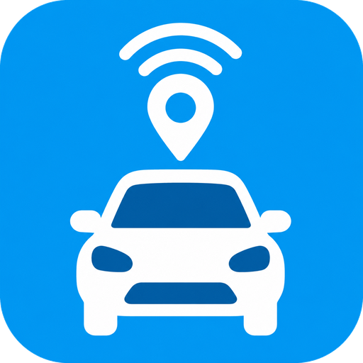

<div align="center">



# 🚗 Movistar Car for Home Assistant

**Your connected car, live in Home Assistant.**
GPS position, fuel and range, battery voltage, driving score, ITV date, WiFi data pack and more, from your Movistar Car / Movistar Mobility device.

[](https://hacs.xyz)


</div>

---

## ✨ Highlights

| | |
|---|---|
| 📍 **Live location** | Device tracker on the HA map, with heading and speed |
| ⛽ **Fuel and range** | Fuel in % and litres, plus an estimated range in km |
| 🔋 **Car battery** | 12 V battery voltage from the OBD port |
| 🏁 **Driving score** | Today's score, this month's score and the full yearly history |
| 🛠️ **Maintenance** | Next ITV date, days left, OBD error count |
| 📶 **WiFi hotspot** | Data pack used, size and expiry date |
| 🚘 **Multi-vehicle** | Pick which car to track if your account has more than one |
| ⚙️ **Configurable** | Update interval and tank size, at setup or later |

---

## 📦 Installation

### HACS (recommended)

1. Open **HACS** in Home Assistant.
2. Go to **Integrations → ⋮ → Custom repositories**.
3. Add `https://github.com/lrodriguezesc/movistar-car-ha` as an **Integration**.
4. Search for **Movistar Car** and click **Download**.
5. Restart Home Assistant.

### Manual

1. Copy the `custom_components/movistar_car` folder to `config/custom_components/`.
2. Restart Home Assistant.

---

## ⚙️ Configuration

Go to **Settings → Devices & Services → Add Integration → Movistar Car**.

| Field | Description | Default |
|---|---|---|
| **Email** | Your Movistar Mobility account email | — |
| **Password** | Your Movistar Mobility password | — |
| **Enterprise Key** *(advanced)* | App key used by the Movistar Mobility app. Leave the default. | built in |
| **Update interval** | How often to poll the API, in seconds (30 to 3600) | `300` |
| **Fuel tank capacity** | Tank size of **your** car, in litres (5 to 200) | `45` |

If your account has more than one vehicle, the next step asks which one to track.

### Change the settings later

Click **Configure** on the integration card. You can change the **update interval** and the **fuel tank capacity** at any time. The integration reloads by itself after you save.

> 💡 **Why a tank capacity?**
> The API reports fuel only as a percentage. The integration multiplies that percentage by your tank size to get litres. It then divides the litres by the average consumption to estimate the range. If the tank size is wrong, these two sensors are wrong. The percentage sensor is always correct.

### Re-authentication

If your password changes, HA asks you to sign in again. The integration keeps its session token between restarts and logs in again by itself when the token expires. After repeated failures it asks you to re-authenticate.

---

## 🧩 Entities

All entities belong to one device, named after your car. The device model comes from the vehicle data (for example `OPEL CORSA`).

### 📍 Device tracker

| Entity | Notes |
|---|---|
| **Location** | GPS position. Extra attributes: `heading`, `speed`, `gps_valid` |

### 📊 Sensors

#### Driving

| Entity | Unit | Description |
|---|---|---|
| Speed | km/h | Speed at the last reported position |
| Heading | ° | Direction of travel |
| Parking Status | — | `0` = not parked on the street (value from the API) |
| Odometer | km | Distance counter of the device |
| Trip Odometer | km | Distance counter of the service. It is not a resettable trip. It is offset from the odometer. |
| Driving Score (Today) | — | Score from 0 to 100 |
| Driving Score (Month) | — | Score of the current month. Attributes hold the history, for example `2026-03: 99` |

#### Fuel and car

| Entity | Unit | Description |
|---|---|---|
| Fuel Level | % | Fuel level from the car |
| Fuel (Litres) | L | Fuel level × tank capacity |
| Estimated Range | km | Litres ÷ average consumption. This uses the **certified** consumption, so the real range is usually longer. |
| Average Consumption | L/100 km | Certified consumption of the vehicle model |
| Battery Voltage | V | 12 V car battery |
| OBD Error Count | — | Number of unsolved diagnostic codes |
| Next ITV | date | Next technical inspection date |
| ITV Days Left | d | Days until the inspection. Negative means overdue. |

#### WiFi hotspot

| Entity | Unit | Description |
|---|---|---|
| WiFi SSID | — | Hotspot name |
| WiFi Data Used | MB | Data used in the current pack |
| WiFi Data Pack Size | MB | Size of the current pack |
| WiFi Data Pack Expiry | timestamp | When the pack expires |

#### Timestamps

| Entity | Description |
|---|---|
| Last Reception | When the device last sent data |
| Location Time | Time of the last GPS fix |
| Data Synced | When HA last read the API |

#### Disabled by default

Enable these in the entity settings if you need them.

| Entity | Description |
|---|---|
| WiFi Password | 🔒 Hotspot password. Enable it only if you need it. |
| WiFi IP Address | IP address of the hotspot |
| SIM Number | Phone number of the SIM |
| Device Battery | Battery of the device. Cars with OBD power often return no value. |
| Activation Date / Association Date / Disconnection Date | Device life-cycle dates |
| Event Type | Code of the last event |
| Latitude / Longitude | Position as separate sensors |
| Last Alarm | Time of the last anti-theft alarm |

### 🔘 Binary sensors

| Entity | Class | On means |
|---|---|---|
| Connected | connectivity | The device is online |
| Moving | moving | Speed is above 0 |
| OBD Errors | problem | There is at least one unsolved diagnostic code |
| WiFi Enabled | connectivity | The hotspot is on |
| GPS Valid | — | The last GPS fix is valid |
| Alarm Armed *(disabled)* | — | The anti-theft alarm is armed |
| Incompatible *(disabled)* | problem | The device is marked as incompatible |

---

## 🏠 Ideas for automations

**ITV reminder**

```yaml
automation:
  - alias: "Car: ITV due soon"
    trigger:
      - platform: numeric_state
        entity_id: sensor.movistarcar_itv_days_left
        below: 30
    action:
      - service: notify.notify
        data:
          message: "ITV due in {{ states('sensor.movistarcar_itv_days_left') }} days"
```

**Low range alert**

```yaml
automation:
  - alias: "Car: low range"
    trigger:
      - platform: numeric_state
        entity_id: sensor.movistarcar_estimated_range
        below: 100
    action:
      - service: notify.notify
        data:
          message: "About {{ states('sensor.movistarcar_estimated_range') }} km of fuel left"
```

**Car started moving**

```yaml
automation:
  - alias: "Car: moving"
    trigger:
      - platform: state
        entity_id: binary_sensor.movistarcar_moving
        to: "on"
    action:
      - service: notify.notify
        data:
          message: "The car is on the move"
```

> Entity IDs depend on your vehicle name. Check yours in **Settings → Entities**.

---

## 🔌 How it works

The integration talks to the **Movistar Mobility / Net4Things** cloud API, the same one the official mobile app uses. It polls on your update interval and makes these calls:

| Call | Used for |
|---|---|
| `GET /session` | Device, service and vehicle data (voltage, km, WiFi, score, ITV, consumption) |
| `GET /session/location-status/{i}` | GPS position, speed, fuel, heading, parking status |
| `POST /obd-diagnostic-codes/{service}/query` | OBD diagnostic codes |

There is no push channel. The **device itself** reports to the cloud only when the car is on or at certain events. When the car is parked, `Last Reception` can be hours old. This is normal.

See **[docs/API.md](docs/API.md)** for the full response structure, the fields we do not use yet and the known pitfalls.

---

## 🩺 Troubleshooting

| Problem | Cause and fix |
|---|---|
| Everything is "unavailable" | The API or your network is down. Check the log for `movistar_car`. |
| Position is old | The device sends data only when the car runs. Check `Last Reception`. |
| "Authentication failed" repair | Password changed. Use **Re-authenticate** on the integration. |
| Litres or range look wrong | Set the correct tank size under **Configure**. |
| WiFi data is 0 | Update to 1.1.0 or later. Earlier versions read the wrong field. |
| Range looks too high | It uses the certified consumption. Real driving uses more fuel. |

---

## 🗺️ Roadmap

- [ ] Trips list (distance, duration, fuel). Needs the trips endpoint, which is not known yet.
- [ ] OBD code history.
- [ ] Geofences and alerts.
- [ ] Per-trip driving score.

The endpoint paths for these are not public. The app traffic must be captured to find them. Contributions are welcome.

---

## 📝 Changelog

### 1.1.1
- **New:** integration icon (`brand/icon.png`, shown by Home Assistant 2026.3 or newer).

### 1.1.0
- **New:** driving score (today and month, with history), next ITV date and days left, average consumption, fuel in litres, estimated range, WiFi pack expiry, alarm sensors.
- **New:** `fuel tank capacity` option. Set it at setup or under Configure.
- **New:** update interval is now also asked at setup.
- **New:** the device model shows the vehicle make and model.
- **Fix:** WiFi data used and pack size now read the real data pack. They showed 0 or a wrong value before.

### 1.0.2
- Retry authentication twice, 10 minutes apart, before asking for re-authentication.

### 1.0.1
- Default update interval changed to 300 s. More sensors.

---

## ⚖️ Disclaimer

This is an unofficial project. It is not affiliated with or approved by Telefónica / Movistar. It uses an API that is not documented, and it can change without notice. Use it at your own risk.

## 📄 License

MIT
